# DALDAL v1 — ภาพรวมระบบ

แผนภาพทั้งหมดเขียนด้วย Mermaid (GitHub แสดงเป็นภาพให้อัตโนมัติ) แก้ไขตามโค้ดได้ในไฟล์นี้

1. [ภาพรวมการ deploy](#1-ภาพรวมการ-deploy)
2. [ชั้นของโค้ด](#2-ชั้นของโค้ด)
3. [ลำดับการทำรายการ (action)](#3-ลำดับการทำรายการ-action)
4. [อัปโหลดไฟล์บิล](#4-อัปโหลดไฟล์บิล)
5. [flow ธุรกิจของร้าน](#5-flow-ธุรกิจของร้าน)
6. [สถานะเอกสาร](#6-สถานะเอกสาร)
7. [ฐานข้อมูล](#7-ฐานข้อมูล)
8. [สิทธิ์ตามบทบาท](#8-สิทธิ์ตามบทบาท)
9. [การทดสอบ](#9-การทดสอบ)

---

## 1. ภาพรวมการ deploy

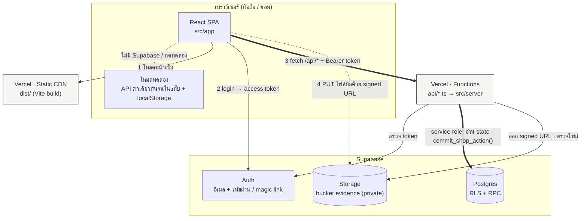

- client **ไม่เขียนฐานข้อมูลตรง** การเปลี่ยนข้อมูลทุกอย่างผ่าน `/api` ซึ่งใช้ service role
- client อ่านได้ตรงเฉพาะร้านของตัวเอง, รายชื่อสมาชิก และ (owner/manager) audit กับไฟล์หลักฐาน ผ่าน RLS
- โหมดทดลองไม่ต่ออินเทอร์เน็ต ใช้ `createApp` ตัวเดียวกับ server ต่อกับ store ในหน่วยความจำ

## 2. ชั้นของโค้ด

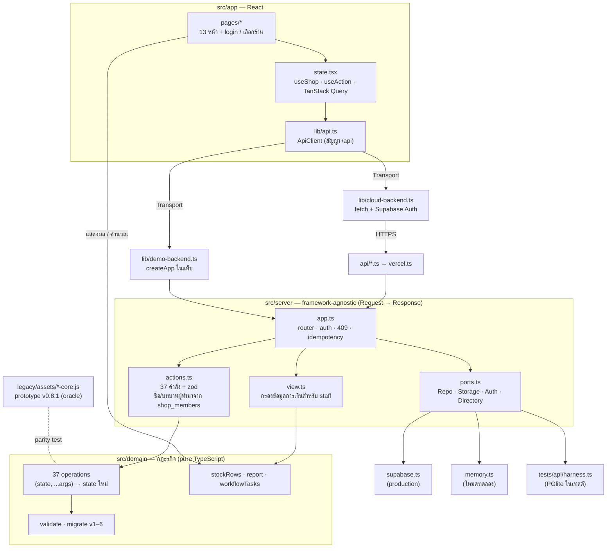

- `src/domain` ไม่รู้จัก React, HTTP หรือฐานข้อมูล ใช้ได้ทั้งในเบราว์เซอร์และบน server
- server เป็นผู้ตัดสินกฎจริง ส่วน client ใช้ domain เพื่อแสดงผล (ยอดคงเหลือ, งานวันนี้, ข้อควรตรวจ)
- `ports.ts` ทำให้ใช้โค้ด API ชุดเดียวกันได้สามที่: Supabase จริง, โหมดทดลอง และเทสต์

## 3. ลำดับการทำรายการ (action)

ตัวอย่าง: ผู้จัดการยืนยันรับสินค้า

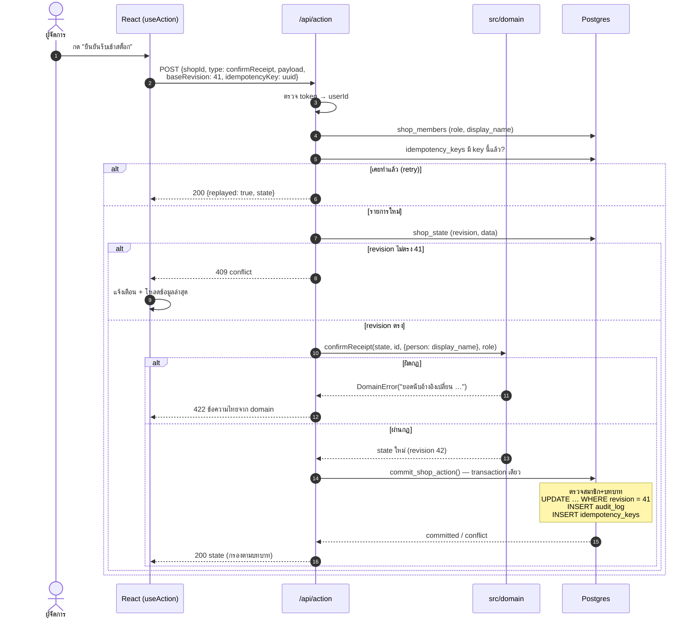

| สถานะ | ความหมาย | หน้าจอทำอะไร |
|---|---|---|
| 200 | สำเร็จ (หรือ `replayed` / `unchanged`) | อัปเดต cache แสดง toast |
| 400 | payload ผิดรูป (เช่นแนบ `person` มาเอง) | แสดงข้อความในฟอร์ม |
| 401 / 403 | ยังไม่ login / ไม่มีสิทธิ์ | ไปหน้า login / แจ้งเตือน |
| 409 | คนอื่นแก้ข้อมูลไปก่อน | โหลดใหม่ ให้ผู้ใช้กดอีกครั้ง |
| 422 | ผิดกฎธุรกิจ | แสดงข้อความไทยจาก domain |

## 4. อัปโหลดไฟล์บิล

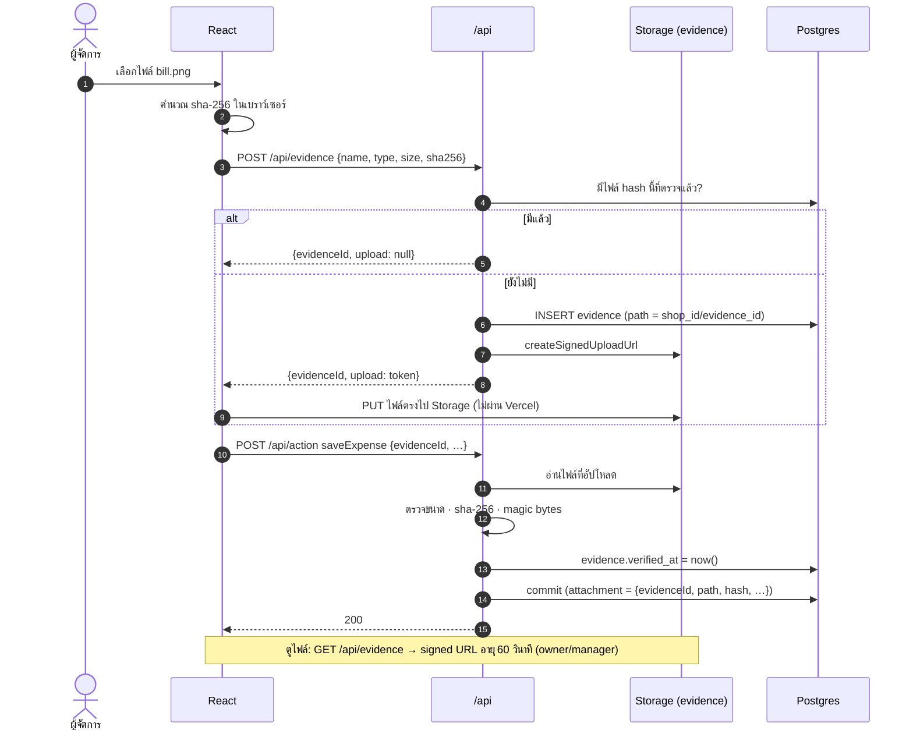

## 5. flow ธุรกิจของร้าน

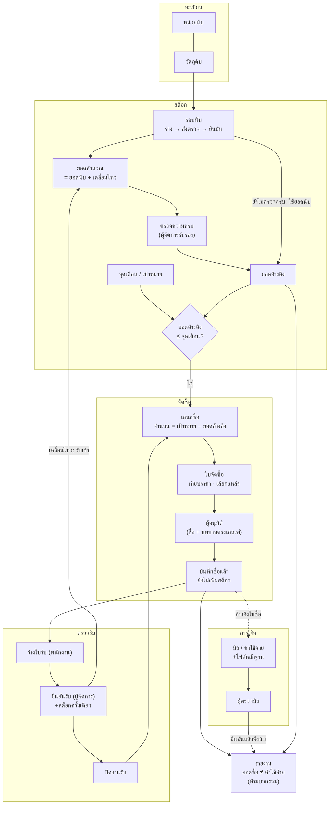

## 6. สถานะเอกสาร

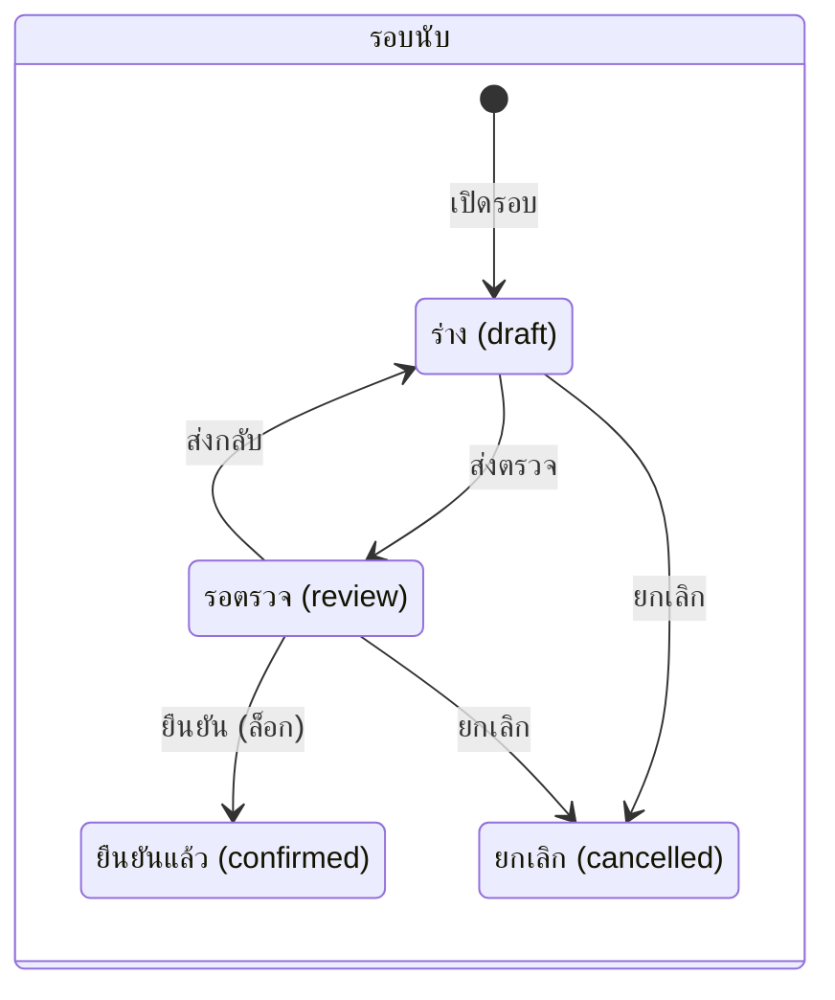

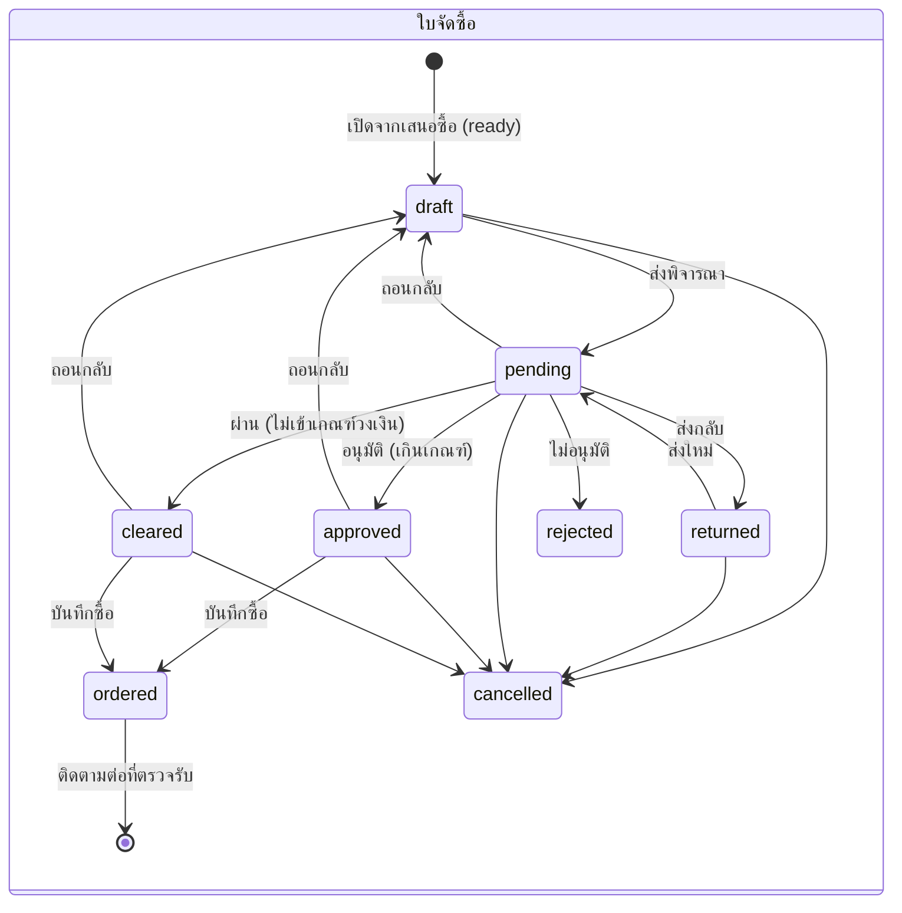

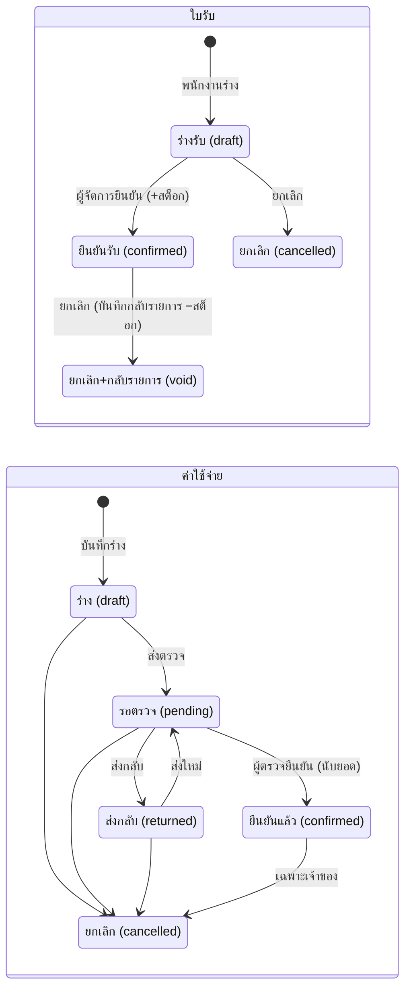

## 7. ฐานข้อมูล

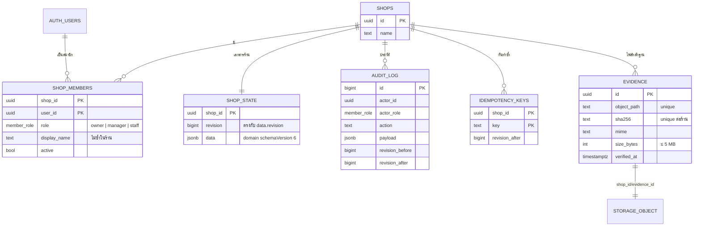

| ตาราง | client อ่าน | client เขียน |
|---|---|---|
| `shops`, `shop_members` | ร้านของตัวเอง | ไม่ได้ |
| `shop_state` | **ไม่ได้** (อ่านผ่าน `/api/state` ที่กรองตามบทบาท) | ไม่ได้ |
| `audit_log` | owner / manager | ไม่ได้ (append-only) |
| `evidence`, bucket `evidence` | owner / manager | ไม่ได้ (signed upload ผ่าน `/api`) |
| `idempotency_keys` | ไม่ได้ | ไม่ได้ |

เอกสารร้านทั้งก้อนเก็บใน `shop_state.data` (jsonb) รูปแบบเดียวกับ prototype ทำให้นำเข้า backup เดิมได้ทันที
ถ้าภายหลังต้องทำรายงานหนักหรือ query ข้ามร้าน ค่อยแยกเป็นตารางย่อยทีละโดเมน

## 8. สิทธิ์ตามบทบาท

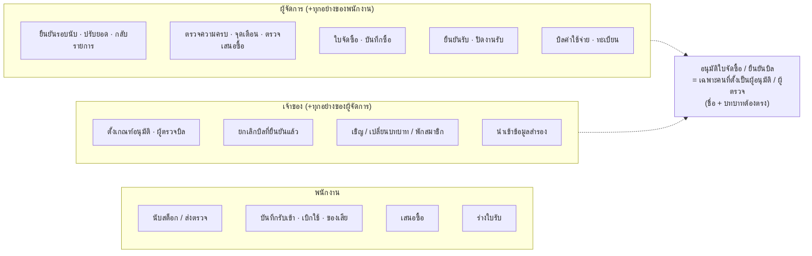

พนักงานไม่ได้รับข้อมูลบิล ราคา ยอดซื้อ หรือวงเงินจาก server เลย ไม่ใช่แค่ซ่อนในหน้าจอ

## 9. การทดสอบ

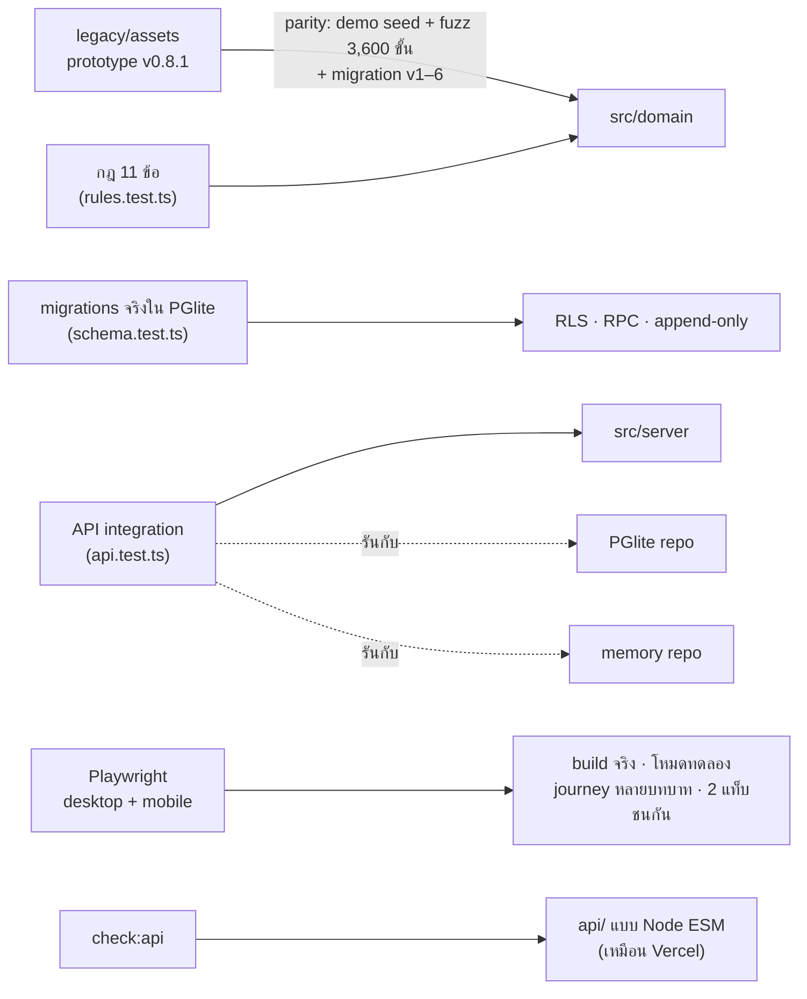

| คำสั่ง | ตรวจอะไร |
|---|---|
| `npm test` | domain, ฐานข้อมูล, API (Vitest) |
| `npm run test:e2e` | build แล้วรัน Playwright |
| `npm run check:api` | คอมไพล์และเรียก `api/` แบบที่ Vercel รัน |
| `npm run legacy:test` | unit tests เดิมของ prototype |
